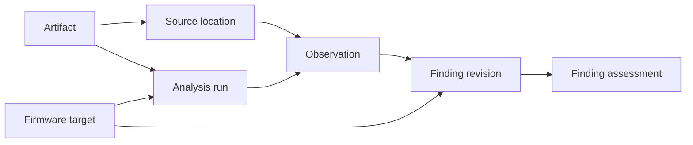

# Evidence data model

Status: accepted logical design. The schema, static observation workflow, and linked finding revisions are implemented. Assessment and dependency invalidation workflows and the other gaps listed in [implementation status](implementation-status.md) remain outstanding; the model below remains the intended contract.

## Purpose and first workflow

An analyst opens an IPSW, selects an exact device/build identity, explores components and hardware descriptions, and compares another image. A finding must answer a question about the virtual machine and let the analyst inspect its basis. The same model must later accept runtime evidence without treating static inspection as proof of working hardware behavior.

## Container layers and reusable components

An IPSW is a ZIP archive. Its members include manifests, firmware payloads, and disk images. A disk image may decode through UDIF/DMG to disk bytes, optional partitions, and an APFS or other filesystem. A device tree or kernel payload can take a different route. These are conditional layers, not a mandatory single pipeline. Blacktop's [IPSW metadata implementation](https://github.com/blacktop/ipsw/blob/master/pkg/info/info.go) resolves build identities and component paths and accepts ZIP entries.

Go's [archive/zip](https://pkg.go.dev/archive/zip) is the starting candidate for the outer archive. Existing packages in [blacktop/ipsw](https://github.com/blacktop/ipsw) are candidates for firmware metadata and payload parsing. This is a dependency shortlist, not an adoption or compatibility claim.

[go-apfs-v3](https://github.com/deploymenttheory/go-apfs-v3) supplies the inner image/filesystem layers. Local source inspected initially at `f3ef6de75eec83c6e77975d21290d732b60d51e6`, with the codec claim rechecked at `e638a67df46239562bbf5143cc20be76a4d3c0bf`, exposes sized random-access sources, image decoding and explicit partition selection, APFS volumes/views, and file identities independent of pathnames. Its UDIF reader supports raw, zero, zlib, and bzip2 chunks and explicitly rejects other codecs, segmented UDIF, and binary-plist UDIF metadata. Filesystem decompression is a separate capability: the repository documents stored, zlib, LZVN, LZFSE, LZBITMAP, and Apple framed LZ4 decmpfs reading. Relevant files: `block/source.go`, `diskimage/image.go`, `diskimage/udif.go`, `apfs/container.go`, and `filesystem/metadata.go`. The `openUDIF` switch admits chunk kinds 0, 2, 1, `0x80000005`, and `0x80000006`; other kinds return `ErrUnsupported`. The original source review ran no real-image trial. A later bounded read of the exact iPhone12,1 iOS 14.0 image confirmed that its OS DMG uses unsupported LZFSE UDIF chunk kind `0x80000007`. This specific gap is tracked in [go-apfs-v3 #146](https://github.com/deploymenttheory/go-apfs-v3/issues/146), under the [dependency ownership decision](adr/0002-codec-capabilities-in-go-apfs.md). It does not imply a filesystem decompression gap or completed image qualification.

The resulting new Go work is expected to include source-location adapters, target-aware hardware findings, comparison semantics, and connections to machine requirements. Reuse of a parser does not by itself supply those contracts.

## Logical records

These are domain records, not a commitment to one table per row or finalized Go types.

| Record | Minimum content and purpose |
| --- | --- |
| Firmware target | Exact source image and manifest identity selector; OS version/build, product, board, chip, and variant as available. Separates two identities in one IPSW and the same device across builds. Missing fields remain explicit. |
| Artifact | Identity of source or retained bytes; kind, size, digest and verification state, and availability. Local paths and download URLs are replaceable locations, not identities. A derived artifact records its parent and transformation. |
| Source location | Root artifact plus typed selectors/transforms down to the referenced property, object, byte range, or runtime event. Records the coordinate space, view, and units. |
| Acquisition | Requested device/release/build/channel, discovery source and selected response, resolved asset kind and location, download status, declared versus verified integrity, and resulting artifact. Downloadability, restore signing status, and VM compatibility are distinct. |
| Analysis run | Tool/parser identity and version, effective relevant options, inputs, target, operation, terminal status, and coverage/gaps. Runtime runs also identify the machine configuration and boot/session. |
| Observation | What a run actually read or recorded, its source location, typed value/raw representation, and presence state. Preserves the original reading when an interpretation changes. |
| Finding revision | Target, subject, property, typed value or unanswered question, observed/inferred/unknown basis, rationale, supporting or contradicting observations/findings, author/tool, and explicit revision relationship. |
| Finding assessment | Review and applicability of a specific finding revision, including accepted, rejected, or disputed state with reason. Acceptance is separate from whether a statement is observed or inferred. |



A firmware target can reference multiple artifacts. A finding can use several observations and other findings. Contradictory findings coexist until resolved explicitly. A cross-image comparison links the two exact targets and explains any subject matching; it cannot equate components solely because their filenames match.

## Source coordinates

For a filesystem-backed source, a possible route is:

```text
IPSW identity
  -> ZIP member identity (entry identity as well as path)
  -> image decode transform
  -> partition identity and decoded-disk range
  -> APFS container, volume UUID, selected checkpoint/snapshot
  -> file object identity and fork/attribute
  -> logical byte offset and length
```

A different route can be `ZIP member -> IMG4 payload -> decompression -> device-tree node/property`. A Mach-O location needs its image identity and coordinate kind, such as file offset or unslid virtual address. A runtime event needs a run/boot identifier, event sequence, clock domain, and relevant CPU/address space. Runtime ordering must not be inferred from incomparable timestamps.

Compression may prevent mapping a logical range to one contiguous range in the parent file. Preserve the decoding recipe and logical location; do not invent a physical offset. Parent relationships are acyclic. Digests are labeled by algorithm and exact byte scope. A declared digest is distinct from one computed and verified. Partial sources cannot masquerade as a verified complete image; provisional records remain explicit until resolved.

## Tracking and interpretation rules

- An observed value is scoped to its target, source view, parser, and run. A property named `reg` can support an address-range reading; it does not establish the behavior of registers in that range.
- Separate present, absent, and unexamined states. Unsupported decoding, missing credentials, partial coverage, and operation failure are distinct outcomes. Absence requires a completed search of the stated scope. Zero and an empty value remain real values.
- Preserve typed values and units, including full unsigned 64-bit addresses. JSON consumers must not lose precision through floating-point numbers. Unsigned firmware values use decimal strings in typed number objects; byte ranges use JSON string-encoded integers. Raw bytes remain available for reinterpretation.
- Rerunning the same extraction records a new attempt but can reference identical observations and artifacts. It does not create another full evidence copy or increase confidence merely through repetition.
- Correct a finding by creating a linked revision. A changed parser's reading is a new observation. Changes to evidence mark dependent assessments for re-evaluation rather than silently transferring acceptance.
- A crash or cancellation preserves an interrupted run and only completed observation batches. Restarting resumes explicit work; it does not label incomplete coverage complete.
- A changed or unavailable input retains its historical identity and is reported as changed or unavailable. Path relocation can be recorded without rewriting findings. Reproduction requires verified matching content.

## PostgreSQL evidence storage

PostgreSQL is the selected system of record for targets, source identities, observations, finding revisions, assessments, provenance, and retained supporting bytes. This supersedes the SQLite/local-blob proposal. The database must contain the evidence needed to inspect a retained finding, not just a pathname to a temporary capture.

Proposed physical representation: relational keys and constrained columns for identity, state, relationships, and review; typed/versioned structured values for format-specific observations; deduplicated binary evidence addressed by digest and exact byte scope. PostgreSQL provides [binary storage through `bytea`](https://www.postgresql.org/docs/current/datatype-binary.html) and a separate [large-object facility](https://www.postgresql.org/docs/current/largeobjects.html). Prefer bounded `bytea` chunks with a manifest of ordered chunks so capture and reading can remain bounded. The initial implementation uses pgx, tern migrations, SHA-256-addressed blobs and ordered chunks of at most 1 MiB.

An evidence object is incomplete while chunks are being captured. Publish its complete manifest and supporting observation relationships only after lengths and digests match. Interrupted captures cannot appear as complete evidence. Identical supporting bytes can be shared; each observation keeps its own target/run/source coordinates. Deleted/unavailable support must never look like an empty byte sequence.

Use transactions for completed observation batches and linked findings. Enforce referential integrity for live evidence references. Schema migrations and backup/restore must preserve relationships, binary evidence, and source identities. JSON is a versioned interchange/query format, not a requirement to write report files from every command. Connection secrets remain configuration and are not copied into run provenance.

Agreed: keep whole downloaded IPSWs in a managed on-demand cache, with acquisition provenance, verified identity, and the evidence supporting findings in PostgreSQL. Cache entries can be reacquired where the exact source remains available; cache availability is separate from retained database evidence. A missing source can require reacquisition for new analysis, while existing retained evidence remains inspectable from the database. Apple availability must not be assumed permanent.

Agreed deployment: provide a dedicated local PostgreSQL instance for development and configure its connection through Viper so a remote instance can also be used. Provisioning uses a dedicated PostgreSQL 17.7 Compose service; credentials are generated locally in an ignored mode-0600 `.env`.

The inspection database is not the runner's state store. The runner consumes an explicit machine contract and does not require the inspection database at runtime.

## Proposed PostgreSQL records and publication contract

The logical records above map to a small relational schema. Names are proposed; implementation must preserve their semantics.

| Record/table family | Keys and relationships |
| --- | --- |
| `artifact`, `artifact_location` | Stable artifact ID; declared and verified digest scopes kept separate; one artifact may have multiple cache/download locations |
| `firmware_target` | Artifact ID plus exact manifest identity selector; product/board/build fields; unique target within that source |
| `acquisition`, `acquisition_step` | Requested identity and selected result; ordered resolution/download/verification steps; references to retained catalog response evidence |
| `analysis_run`, `run_input`, `coverage` | Run ID, exact target/input IDs and effective options; explicit per-component coverage and terminal state |
| `source_location` | Artifact ID, coordinate-kind version and typed selector chain; exact view/address-space and range |
| `evidence_blob`, `evidence_chunk`, `blob_chunk` | Blob identity, expected byte length and completion state; digest-addressed bounded binary chunks; ordered chunk membership and offsets |
| `observation`, `run_observation` | Source location, value/presence, extraction identity and supporting blob references; run associations permit reuse without claiming new independent evidence |
| `finding`, `finding_revision`, `finding_basis` | Stable target/subject/property question; versioned answers and rationale; typed supporting or contradicting observation/revision references |
| `finding_assessment_event` | Append-only review decision or needs-review invalidation for an exact revision and basis, with reviewer reason, predecessor and changed-revision cause; acceptance does not propagate to replacements |
| `operation_progress`, `operation_progress_event` | Durable current acquisition/run state and capped phase history; inspection batch and checkpoint counters commit with their evidence, while downloaded and verified byte counters are coalesced |

Use UUID-like record identities independent of paths and typed digest identities for bytes. Enforce foreign keys, uniqueness for canonical source/target identities, and valid state transitions. Keep structured extensions versioned rather than treating arbitrary JSON as a substitute for relational ownership. Store full unsigned addresses without signed-integer overflow or JSON floating-point conversion. Format-specific source selectors must validate their coordinate kinds and bounds.

A producer stages bounded binary chunks and a manifest. Lengths, byte order, chunk digests and the complete blob identity must agree before publication. In a transaction, mark the verified blob complete and link completed observations and their run coverage. A finding may reference only published observations/evidence. A failed transaction cannot leave a finding with a dangling evidence reference. Unreferenced staging chunks are eligible for cleanup; active uploads are protected.

Use idempotent keys for retrying a publication batch. Do not hold a database transaction open while downloading or decoding an entire image. Concurrent workers may publish independent batches; final run completion requires accounting for all requested components. Serialize any contested finalization with database constraints/locking rather than relying on the CLI process being unique.

Schema migrations must be versioned and use an existing migration engine. The domain model is independent of SQL. A migration/backup/restore check must include binary evidence and revision links, not only empty tables. The initial schema and service now exist; qualification details are tracked separately.

## On-demand acquisition

The user selected on-demand acquisition using GDMF. [Apple's software-update documentation](https://developer.apple.com/documentation/devicemanagement/deploying-software-updates-using-declarative-management) describes `GET https://gdmf.apple.com/v2/pmv` as release availability metadata, including version, build, dates, and supported devices. Its documented response does not supply a restore IPSW URL.

Existing Go tooling keeps these paths distinct: [blacktop's GDMF asset-set client](https://github.com/blacktop/ipsw/blob/master/internal/download/asset_sets.go) consumes release metadata; its [Pallas asset client](https://github.com/blacktop/ipsw/blob/master/internal/download/ota.go) uses `POST https://gdmf.apple.com/v2/assets` for asset queries, including the iOS software-update/OTA route. A full OTA remains an OTA, not a restore IPSW. Its separate [iTunes catalog client](https://github.com/blacktop/ipsw/blob/master/internal/download/itunes.go) resolves `Restore.FirmwareURL` through an Apple-owned catalog. These sources demonstrate separate resolution mechanisms, not guaranteed historical coverage.

Agreed acquisition policy: discover the requested device/release through GDMF first, then use supplemental Apple-owned restore catalogs where needed to resolve the exact restore IPSW. Preserve the distinction between discovery, asset resolution, download, and manifest verification. Do not silently substitute a different build, device, or asset kind. If no resolver finds the requested build, report the sources checked and the unresolved target; absence from a current feed is not proof that Apple no longer hosts the image.

Retain acquisition evidence in PostgreSQL: the exact request, catalog endpoint and relevant original response, retrieval time, resolution steps and no-match results, selected URL, expected versus measured size/digests, and final archive manifest identity. Store relevant response bytes once per unique response and record queries by reference; avoid producing a report tree per attempt. Artifact availability, restore signing status, and VM compatibility are separate properties.

Live PMV and iTunes requests succeeded on 2026-10-22. Neither returned an exact iPhone12,1 match for 14.0 or 15.0. The broad iPhone12,1 query returned current release metadata and one 27.0.1 restore candidate. These were catalog observations, not verified image identities. Subsequent historical resolution and image qualification are recorded in [qualification](qualification/historical-resolution.md).

## Retention policy

Retain findings, their meaningful revisions, source references, necessary supporting observations, and required supporting bytes in PostgreSQL. Treat decoded files, generated reports, and unselected bulk traces as caches with configurable limits. Durable evidence also needs an explicit budget so growth is not merely relocated from files into PostgreSQL. Selected runtime events require retained supporting data when they cannot be recreated from an immutable image; account for dropped events and capture gaps.

Cleanup may remove reproducible cache material. It must not delete externally supplied originals or the only retained support for an active finding. If the essential evidence budget is exhausted, stop additional capture with a clear result. Explicitly discarding essential material records its loss of availability. Deleting a cache must leave findings queryable and must say when re-reading a source is required. Initial limits and their exact scope are documented in the README; database overhead is accounted separately from retained source-byte limits.

## Relationship to the runner

Agreed: findings inform an explicit, versioned machine contract/profile through reviewed implementation decisions. Choosing a register address or interpreting a device dependency requires a recorded implementation decision; extraction alone does not change runtime behavior. The runner consumes its contract without requiring the research database. Inferred behavior may be tested deliberately, but remains an inference until supporting evidence exists. Profile format and complete subsystem contracts are a later design branch.

## Conformance scenarios for the model

1. Two identical filenames with different contents remain distinct; moving a source file preserves identity after matching verification.
2. Two build identities in one IPSW, or the same board in two releases, cannot contaminate each other's findings.
3. A decoded file range is retrievable through its named layers, or returns an explicit unsupported/unavailable result.
4. A missing property, a present zero, and a failed parser produce distinct outcomes.
5. A parser upgrade that contradicts an earlier reading preserves both observations and exposes the conflict.
6. Interruption leaves completed records readable and coverage incomplete; repeat work does not duplicate retained blobs.
7. Cache cleanup preserves active findings and their necessary evidence; missing external originals are reported accurately.
8. A trace with event loss cannot establish an absence claim for the missing interval.
9. A database backup/restore preserves selected supporting bytes and their relationships; deleting a local capture cache does not remove that evidence.
10. An interrupted evidence upload cannot publish a complete manifest or duplicate already retained chunks on retry.
11. Acquiring an exact target distinguishes an unavailable catalog entry, an unresolved download location, an interrupted download, and a verified restore IPSW.

These are acceptance scenarios. The implementation status distinguishes checked behaviors from outstanding real-image and revision-workflow qualification.

## Design review state

Storage, retention, acquisition sources, cache placement, local/remote deployment, macOS/Linux tool qualification and the same-hardware iOS 14/15 comparison are settled. Windows is out of scope; the runner targets Apple Silicon macOS. This schema and the [inspection architecture](inspection-architecture.md) were accepted at the final shared-understanding review. The exact iOS 14 archive is now verified, with partial parser coverage and measured command resources in its [qualification record](qualification/iphone12-1-ios14.md). The iOS 15 archive, complete format support, and resource defaults remain to be qualified.
