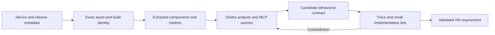

# Deriving iOS VM requirements from Apple firmware

Research date: **24 October 2026**. Companion to [the iOS VM project survey](research.md).

Accuracy review: see the [adversarial audit](research-accuracy-audit.md) and [independent source checks](research-verification-projects.md). Historical metadata hashes without retained responses are not independently reproducible evidence.

The [virtualization reference map](virtualization-reference-map.md) adds a reading order and annotated Apple, GitHub, blog and tracing references for the future project.

The [Simulator Clang AST assessment](simulator-clang-ast-research.md) adds local SDK/compiler experiments, device-versus-Simulator API differences and opportunities for userspace comparison.

## Assessment

**Analyzing current firmware is a credible way to recover software-visible requirements for an iOS VM.** The useful output is a set of evidenced contracts: boot inputs, device discovery, register accesses, messages, shared-memory layouts, interrupts, completion conditions and failure paths. This is a proposed research method, not a claim that these contracts have already been recovered here.

Ghidra supplies binary analysis; Ghidra MCP integrations automate access to it; GDMF helps select applicable releases; firmware tooling extracts the relevant components. These serve different roles. Static analysis still needs runtime evidence to establish which paths execute and whether an implementation behaves correctly. Ghidra itself describes its GUI emulation primarily in terms of smaller instruction/function scopes, rather than a ready-made complete device model. [Ghidra overview](https://github.com/NationalSecurityAgency/ghidra), [official emulation documentation](https://ghidra.re/ghidra_docs/GhidraClass/Debugger/B2-Emulation.html)

Recommendation: study the newest applicable retail firmware **alongside a known-working virtual-platform firmware pair**. This preserves a working reference for experiments while exposing changes in newer software. A failure to boot a new image otherwise conflates incompatible firmware, an incorrect loader, missing virtual devices and an incorrect behavioral hypothesis.

## 1. Ghidra and Apple binary analysis

### Capabilities and version selection

The NSA repository is the upstream Ghidra reverse-engineering framework. It provides disassembly, decompilation, analysis, scripting and extensibility; its license is Apache-2.0. The release list shows **Ghidra 12.2, released 22 October 2026**, as latest when checked. [Repository](https://github.com/NationalSecurityAgency/ghidra), [releases](https://github.com/NationalSecurityAgency/ghidra/releases)

Do not combine current development instructions and older extension requirements indiscriminately. Upstream's current README requests JDK 25, whereas the **12.1.4** Getting Started document specifies JDK 21. A matching release, JDK, native decompiler and extension build should be recorded as one toolchain. [Current README](https://github.com/NationalSecurityAgency/ghidra/blob/master/README.md), [12.1.4 requirements](https://github.com/NationalSecurityAgency/ghidra/blob/Ghidra_12.1.4_build/GhidraDocs/GettingStarted.md)

For this investigation, an initial compatibility baseline is Ghidra 12.1.4 + JDK 21 with a matching LaurieWired extension and Python 3.13 for its documented headless mode. Ghidra 12.2 is a separate upgrade candidate requiring loader and extension validation. Using a slightly older analysis release does not inherently prevent studying newer firmware; successful import and correct instruction analysis must be demonstrated for the actual component. [Integration prerequisites](https://github.com/LaurieWired/GhidraMCP#readme)

### Importing firmware is a separate engineering step

Ghidra contains Mach-O and dyld-cache loaders, including cache pointer-fixup options. These are relevant building blocks, not proof that every current firmware container or kernelcache imports correctly. [Mach-O loader source](https://github.com/NationalSecurityAgency/ghidra/blob/master/Ghidra/Features/Base/src/main/java/ghidra/app/util/opinion/MachoLoader.java), [dyld-cache loader source](https://github.com/NationalSecurityAgency/ghidra/blob/master/Ghidra/Features/Base/src/main/java/ghidra/app/util/opinion/DyldCacheLoader.java)

The `ipsw` maintainer documents modern kernelcaches as Mach-O filesets, with separate kernel/KEXT entries, and release kernels as stripped. Extract/decompress the container, identify the correct fileset member, preserve virtual addresses and verify references before trusting pseudocode. Symbol recovery and C++/IOKit reconstruction help navigation; recovered names are supporting annotations, not original source or proof of semantics. [Kernel-analysis reference](https://github.com/blacktop/ipsw-skill/blob/main/ipsw/references/kernel.md)

The older [0x36/ghidra_kernelcache](https://github.com/0x36/ghidra_kernelcache) framework is useful prior art for IOKit class and virtual-method reconstruction. Its README advertises iOS 12–15 and macOS 11–12, so current-firmware compatibility remains unverified. Historical claims that Ghidra cannot load a particular kernelcache must not be generalized to every current release. [Project documentation](https://github.com/0x36/ghidra_kernelcache#readme)

Apple's [published XNU source](https://github.com/apple-oss-distributions/xnu) supplies another reference. Match the binary's XNU build and validate corresponding routines; do not assume the public source tree represents all proprietary platform drivers in the distribution image.

Ghidra Version Tracking can transfer established annotations between related programs, but matching functions is not equivalent to proving unchanged behavior. Compiler changes and changed calling contexts require review. [Official Version Tracking documentation](https://github.com/NationalSecurityAgency/ghidra/blob/master/Ghidra/Features/VersionTracking/src/main/help/help/topics/VersionTrackingPlugin/Version_Tracking_Intro.html)

## 2. Ghidra MCP implementations

“Ghidra MCP” names several independent integrations, not a single NSA-maintained interface. Their release requirements and transports differ.

| Integration | Documented architecture and useful features | Compatibility and suitability |
| --- | --- | --- |
| [LaurieWired/GhidraMCP](https://github.com/LaurieWired/GhidraMCP) | Java Ghidra extension with a Python MCP bridge; decompilation, symbols, references and annotations; GUI and PyGhidra-based headless operation. Apache-2.0. | README specifies Ghidra 12.1.4; headless mode specifies Python 3.10–3.13. Good initial pilot because the documented toolchain is explicit. [README](https://github.com/LaurieWired/GhidraMCP#readme), [package metadata](https://github.com/LaurieWired/GhidraMCP/blob/main/pyproject.toml) |
| [bethington/ghidra-mcp](https://github.com/bethington/ghidra-mcp) | An extended derivative with GUI/headless servers, batch operations, cross-binary workflows, and advertised debugger/P-code capabilities. Apache-2.0. | Current README also specifies 12.1.4 and says the extension loads only in the exact version it was built for. Assess required operations rather than advertised tool counts. [README](https://github.com/bethington/ghidra-mcp#readme) |
| [symgraph/GhidrAssistMCP](https://github.com/symgraph/GhidrAssistMCP) | Native Java MCP extension with SSE/Streamable HTTP, multi-program support, asynchronous tasks and individually configurable tools. MIT. | Current prerequisites specify Ghidra 12.0 or 12.1 Public and Java 25+, with version-specific extension packages. The earlier 11.4+ statement was not supported by the checked README. Validate the exact release combination. Its headless script has an explicit wait mode for interactive sessions. [Prerequisites](https://github.com/symgraph/GhidrAssistMCP#prerequisites) |

The LaurieWired implementation exposes both investigation operations and project mutations: function/data renaming, type changes and comments. Its function-call queries describe a one-level graph, not exhaustive program behavior. An agent's new labels can influence subsequent decompilation, so retain original addresses and distinguish inferred names from recovered symbols. [Actual MCP tool definitions](https://github.com/LaurieWired/GhidraMCP/blob/main/src/ghidra_mcp/server.py)

Recommended operating pattern: import and analyze a component deterministically first, then let MCP answer bounded questions against a named program. Keep each answer attached to file digest, function address and instruction evidence. Retain project snapshots before annotations, and preserve the original bytes. Start with loopback transport and the minimum needed operations; these integrations can modify analysis state, and some expose broader scripting capabilities. This is a proposed lab configuration, not a claim that all implementations provide the same controls.

MCP acceptance checks should include import, analysis completion, known-function decompilation, reference enumeration, an annotation/save/reopen round trip on a disposable project, and unambiguous selection between two open binaries. No integration was installed or exercised in this session.

## 3. GDMF: release selection, asset discovery and signing

Apple documents `https://gdmf.apple.com/v2/pmv` as its **Software Lookup Service**. Its sets describe public releases, releases available through device management, and Background Security Improvements. Entries carry product version, build, posting/expiration dates and supported device identifiers. Apple describes expiration as an update-signing deadline; preserve these dates and refresh them rather than assuming a permanent availability window. The `iOS` grouping also includes other Apple device families. [Official field semantics](https://developer.apple.com/documentation/devicemanagement/deploying-software-updates-using-declarative-management)

Keep three services distinct:

| Layer | Purpose | What it does not establish |
| --- | --- | --- |
| GDMF PMV (`/v2/pmv`) | Release/build applicability metadata | IPSW download URL, a virtual hardware specification, or successful personalization of a particular image |
| Pallas assets (`/v2/assets`) and firmware indexes | Locate assets using device, board, release audience and other query inputs | That a retail image will boot on a chosen VM |
| Restore/signing authorization | Authorize an appropriate component set for the target context | That modified components or arbitrary mixed builds will be accepted |

`ipsw`'s OTA implementation queries the distinct Pallas endpoint using device/board/audience information. This is implementation evidence for asset discovery, not a guarantee of a stable documented Apple API. Apple's update-security documentation describes component measurements, personalization and anti-replay protections. A feed entry or third-party `signed` boolean is not a successful restore-ticket request. [Pallas query implementation](https://github.com/blacktop/ipsw/blob/master/internal/download/ota.go), [Apple update authorization](https://support.apple.com/en-lamr/guide/security/secf683e0b36/web)

### Live metadata snapshot

The browsing tool initially timed out on GDMF, but a subsequent direct read-only HTTPS query succeeded. The following summarizes the response retrieved at **2026-10-24 15:01:56 UTC**; it does not identify beta-channel head releases. [Live Apple endpoint](https://gdmf.apple.com/v2/pmv)

| Set | Matching device | ProductVersion | Build candidates | PostingDate | ExpirationDate |
| --- | --- | --- | --- | --- | --- |
| `PublicAssetSets.iOS` | `iPhone17,3` | `27.0.1` | `24A446`, `24A6446` | `2026-10-22` | `2027-01-22` |
| `PublicAssetSets.iOS` | `iPhone19,4` only for these entries | `27.1` | `24A95425`, `24A94425` | `2026-10-22` | `2027-01-22` |

The response was 76,529 bytes, SHA-256 `07afbefc13d01ea91e20a0cd1d08353aebe153ab96c4904e1b71bdde71be55e7`. Only the summary and digest are recorded here; the full response was not saved. Multiple builds under one version are candidates to resolve against the desired asset and manifest, not interchangeable firmware.

Apple's security-release page independently lists **27.0.1 generally** and **27.1 for iPhone Duo only**. It dates those releases 28 September and 23 October respectively; those dates differ from PMV's posting dates. Preserve each source's date semantics. [Apple security releases](https://support.apple.com/en-us/100100)

## 4. Deployment Theory's Go SDK

The user-supplied [apple_update_cdn package](https://github.com/deploymenttheory/go-sdk-appleservices/tree/main/apple_update_cdn) was inspected at commit **`87fcc73b017dd2fc1648d295cc38d291f2888a4f`**, committed 24 October 2026. It is a useful Go integration candidate, with concrete adaptation needs identified below. The repository is MIT and declares **Go 1.26.0**; it uses `resty.dev/v3`. [Commit](https://github.com/deploymenttheory/go-sdk-appleservices/commit/87fcc73b017dd2fc1648d295cc38d291f2888a4f), [go.mod](https://github.com/deploymenttheory/go-sdk-appleservices/blob/87fcc73b017dd2fc1648d295cc38d291f2888a4f/go.mod), [license](https://github.com/deploymenttheory/go-sdk-appleservices/blob/87fcc73b017dd2fc1648d295cc38d291f2888a4f/LICENSE)

### Implemented responsibilities

`NewClient` constructs `AppleUpdateCDNAPI`, grouping `GDMF`, `Firmware` and `CDN` services. Despite a macOS-focused entry-point comment, the firmware implementation also contains iPhone/iPad queries. [Client construction](https://github.com/deploymenttheory/go-sdk-appleservices/blob/87fcc73b017dd2fc1648d295cc38d291f2888a4f/apple_update_cdn/apple_update_cdn.go)

| Service | Actual implementation | Use in this project |
| --- | --- | --- |
| `GDMF.GetPublicVersionsV2(ctx)` | GETs Apple's PMV endpoint into three platform-set models; does not return download URLs. | Identify applicable device/version/build candidates and retain feed membership. [Implementation](https://github.com/deploymenttheory/go-sdk-appleservices/blob/87fcc73b017dd2fc1648d295cc38d291f2888a4f/apple_update_cdn/apple_update_cdn_api/gdmf/crud.go) |
| `Firmware.GetByDeviceV4(ctx, identifier)` | Queries the **third-party ipsw.me API**, with `type=ipsw`; platform list and unique-version helpers also exist. | Resolve a specific product's IPSW candidates. Prefer per-device records over a global version list. [Implementation](https://github.com/deploymenttheory/go-sdk-appleservices/blob/87fcc73b017dd2fc1648d295cc38d291f2888a4f/apple_update_cdn/apple_update_cdn_api/firmware/crud.go) |
| `CDN.ParseURL`, `GetFileMetadataV1`, `DownloadFileV1` | Parses URLs, issues metadata-only HEAD requests, or streams full files and computes checksums. | Inspect size/hash before acquisition; full-file download is separate from selective extraction. [Implementation](https://github.com/deploymenttheory/go-sdk-appleservices/blob/87fcc73b017dd2fc1648d295cc38d291f2888a4f/apple_update_cdn/apple_update_cdn_api/cdn/crud.go) |

### Important source and live-response findings

1. **GDMF comment semantics need qualification.** SDK comments characterize entries as currently signed and describe `AssetSets` as potentially seed-program entries. Apple's documentation instead describes the device-management release set. Do not use that SDK comment as a beta-discovery contract or treat it as a successful personalized signing check. [SDK comments](https://github.com/deploymenttheory/go-sdk-appleservices/blob/87fcc73b017dd2fc1648d295cc38d291f2888a4f/apple_update_cdn/apple_update_cdn_api/gdmf/crud.go), [Apple semantics](https://developer.apple.com/documentation/devicemanagement/deploying-software-updates-using-declarative-management)
2. **The typed feed model omits fields seen live.** `AssetEntry` lacks `ProductVersionExtra` and `PrerequisiteBuild`, both present in the queried background-improvement entry. Preserve raw JSON or extend the model before treating it as a complete firmware-selection record; nil platform/set pointers also need handling. [Model](https://github.com/deploymenttheory/go-sdk-appleservices/blob/87fcc73b017dd2fc1648d295cc38d291f2888a4f/apple_update_cdn/apple_update_cdn_api/gdmf/models.go), [Apple response](https://gdmf.apple.com/v2/pmv)
3. **The v4 board model conflicts with the inspected live response.** `DeviceFirmwaresV4Response.Boards` is `[]string`. The `iPhone17,3` response returned an array of objects with `boardconfig`, `platform`, `cpid` and `bdid`. That shape conflicts with typed JSON decoding; validate and adapt it before relying on `GetByDeviceV4`. This was found through source/response comparison, not by running the SDK. [Model](https://github.com/deploymenttheory/go-sdk-appleservices/blob/87fcc73b017dd2fc1648d295cc38d291f2888a4f/apple_update_cdn/apple_update_cdn_api/firmware/models.go), [queried v4 response](https://api.ipsw.me/v4/device/iPhone17,3?type=ipsw)
4. **The parser does not cover the verified current URL.** It requires five path segments, but the resolved IPSW path has three: release directory, UUID and filename. Keep the discovery URL authoritative and use the manifest for identity; do not reconstruct URLs or make this parser a mandatory acquisition gate. [Parser and constants](https://github.com/deploymenttheory/go-sdk-appleservices/blob/87fcc73b017dd2fc1648d295cc38d291f2888a4f/apple_update_cdn/apple_update_cdn_api/cdn/crud.go), [expected structure](https://github.com/deploymenttheory/go-sdk-appleservices/blob/87fcc73b017dd2fc1648d295cc38d291f2888a4f/apple_update_cdn/apple_update_cdn_api/cdn/constants.go)
5. **Global uniqueness loses product context.** The helper deduplicates by build ID across devices and orders by release date. That is useful for a version overview, but must not select an iPhone-specific asset by taking the first global result. [Helper implementation](https://github.com/deploymenttheory/go-sdk-appleservices/blob/87fcc73b017dd2fc1648d295cc38d291f2888a4f/apple_update_cdn/apple_update_cdn_api/firmware/crud.go)
6. **Successful download and verification are separate results.** The downloader can return success with `Verified=false` when checksum headers are absent; it also overwrites an existing destination. A future acquisition layer should require its intended digest policy and use a new staging destination. [Download implementation](https://github.com/deploymenttheory/go-sdk-appleservices/blob/87fcc73b017dd2fc1648d295cc38d291f2888a4f/apple_update_cdn/apple_update_cdn_api/cdn/crud.go)

The inspected GDMF tests use mocked responses and include a service-error case. They establish intended behavior, not current feed freshness or live compatibility. No SDK tests were run here. [Tests](https://github.com/deploymenttheory/go-sdk-appleservices/blob/87fcc73b017dd2fc1648d295cc38d291f2888a4f/apple_update_cdn/apple_update_cdn_api/gdmf/crud_test.go)

### A current artifact resolved without downloading firmware

A direct metadata query to the same v4 API used by the SDK returned this candidate; an Apple CDN HEAD request returned HTTP 200, the same size and SHA-256, and `Accept-Ranges: bytes`. [Discovery metadata](https://api.ipsw.me/v4/device/iPhone17,3?type=ipsw), [Apple-hosted asset](https://updates.cdn-apple.com/2026FallFCS/38dca0ee-bb5d-4132-ad13-62d57bcd6d32/iPhone17,3_27.0.1_24A446_Restore.ipsw)

| Field | Observed value |
| --- | --- |
| Product / board / platform | `iPhone17,3` / `D47AP` / `t8140` |
| Version / build | `27.0.1` / `24A446` |
| Size | `12,343,857,610` bytes |
| SHA-256 reported by both services | `fc87bb9da8c03d0154d87531950f4a170195f6663ee5208653fa7a26bafb9469` |
| Asset path | `2026FallFCS/38dca0ee-bb5d-4132-ad13-62d57bcd6d32/iPhone17,3_27.0.1_24A446_Restore.ipsw` |

This verifies metadata agreement and asset availability. It does **not** verify downloaded bytes, BuildManifest identity, extraction, restore authorization or VM boot. The aggregator's `signed=true` is only a reported status.

## 5. Firmware acquisition and useful comparison targets

### Select components before whole images

The Go SDK handles discovery and whole-file transfers. `blacktop/ipsw` supplies complementary inspection/extraction capabilities, including remote component reads, kernelcaches, device trees, boot firmware and dyld analysis. Container-specific handling can involve IMG4, compressed Mach-O, AEA filesystems and OTA payloads. An OTA may depend on a prerequisite build; do not assume every update asset is a standalone restore image. [Tool overview](https://github.com/blacktop/ipsw), [firmware/container reference](https://github.com/blacktop/ipsw-skill/blob/main/ipsw/references/firmware.md)

These are source-checked examples for a later experiment, **not commands executed in this session**. Set `DEVICE` and `URL` to an inspected, recorded product/build pair first:

```sh
# Inspect the remote archive and extract its identity manifest.
ipsw info --remote "$URL"
ipsw info --remote --list "$URL"
ipsw extract --remote --pattern 'BuildManifest\.plist$' -o ./fw/ "$URL"

# Select the kernel separately from other firmware components.
ipsw extract --remote --kernel --device "$DEVICE" -o ./fw/ "$URL"
ipsw extract --remote --iboot --dtree --sep --sptm -o ./fw/ "$URL"
```

The current command validator rejects combining `--device` with the second extraction call's component flags. Select the correct resulting artifacts using the manifest; `--sptm` extracts SPTM and TXM. Record the installed CLI version and check its help before execution. [Actual command implementation](https://github.com/blacktop/ipsw/blob/master/cmd/ipsw/cmd/extract.go)

For further discovery, the maintainer documents explicit release/beta/RC selection and `ipsw download pcc --latest --urls`. Its AppleDB-backed `--latest` must have an explicit channel filter; AppleDB is another discovery source, not Apple's signing service. [Acquisition reference](https://github.com/blacktop/ipsw-skill/blob/main/ipsw/references/download.md)

### Why virtual-platform firmware is especially valuable

Apple's PCC Virtual Research Environment runs on Apple Silicon and virtualizes both application processors and SEP. Apple explicitly describes firmware changes for virtual hardware, custom kernelcache/SPTM/TXM support and custom cryptexes. This makes it a concrete reference for virtual-platform interfaces, while PCC remains a different system from an iPhone. [Official VRE architecture](https://security.apple.com/documentation/private-cloud-compute/virtualresearchenvironment)

Apple's setup documentation specifies Apple Silicon, at least 16 GB memory, macOS 15.1+, `pccvre` and research-guest configuration. Its research-use/noncommercial terms affect use of that specific environment. These prerequisites are separate from static analysis of extracted binaries. [VRE setup and terms](https://security.apple.com/documentation/private-cloud-compute/vresetup)

The vphone-cli compatibility document provides practical comparison evidence: tested iPhone/cloudOS combinations, guest-daemon checks and version-dependent kernelcache mixing. It explains that newer cloudOS releases removed the earlier `vphone600ap` identity and require research-board adaptations/recipes. Newer retail firmware availability therefore does not imply a matching ready-to-boot virtual kernel. Treat this as project-maintainer evidence, not an Apple compatibility guarantee. [Compatibility and firmware recipes](https://github.com/Lakr233/vphone-cli/blob/main/Documents/Guides/compatibility.md)

Recommended comparison corpus:

1. One exact, documented working iPhone/cloudOS pairing, preserving its original and modified components separately.
2. An adjacent supported version for the same guest identity, to distinguish ordinary release changes from platform changes.
3. The latest applicable retail build, such as the resolved `iPhone17,3` candidate above, as the forward-compatibility analysis target.

### Components and questions

The following are proposed investigation targets, not behaviors observed in downloaded firmware during this survey.

| Component | Evidence to seek | Candidate VM requirement |
| --- | --- | --- |
| BuildManifest / device tree | Build identity, component paths, compatibility strings, memory ranges and interrupt descriptions | Which machine identity and resources drivers expect |
| iBoot / kernel startup | Handoff structures, boot arguments, memory reservations and early console setup | Entry-state and boot-environment contract |
| Kernel / platform KEXTs | Driver matching, register access widths, reset/polling paths, DMA descriptors and interrupt handlers | Device state machines and completion/error behavior |
| SPTM / TXM / SEP interfaces | Calls, messages, ownership changes, shared memory and initialization ordering | Security-subsystem interfaces needed by the selected guest path |
| Storage / display / input drivers | Queue layouts, buffer formats, doorbells, interrupts and lifecycle operations | Minimum devices for filesystem access and interactive graphics |
| dyld / launchd / services | Mapping expectations, entitlements, service dependencies and communication endpoints | Requirements after kernel boot, distinct from hardware bring-up |

Apple documents immutable Boot ROM as the hardware root of trust and separate SEP/baseband boot processes. An IPSW is not a complete silicon specification or necessarily a dump of every ROM. Distribution-image extraction/decryption also does not recover hardware-bound device secrets. [Boot chain](https://support.apple.com/en-au/guide/security/secb3000f149/web), [Secure Enclave architecture](https://support.apple.com/en-au/guide/security/sec59b0b31ff/web)

## 6. Turning analysis into implementation evidence

This is the proposed workflow for this repository; none of these firmware-analysis experiments have been executed yet.



1. **Freeze provenance.** Save raw metadata, UTC retrieval time, release channel, device/board IDs, version/build, source URL, component paths, digests and tool versions. Keep feed posting dates, release dates and retrieval dates distinct. Hash modified components separately.
2. **Validate the loader.** Check architecture, address map, fileset selection, pointer fixups and several known routines in disassembly. A plausible decompilation is insufficient if references are wrong. Test representative arm64e/PAC or newer instructions before using instruction emulation as an oracle.
3. **Ask bounded MCP questions.** For example: “At this function address, identify the driver's initialization writes, subsequent status polling, completion interrupt and error exits; cite instructions and distinguish unknown semantics.” A string match or renamed function alone is a candidate lead.
4. **Compare the working pair with the retail target.** Track which virtual-driver paths are present, replaced, absent or patched. Record every patch's intended purpose and observable effect; a bypass that reaches the next stage does not prove the original hardware behavior was implemented.
5. **Validate one contract.** Begin with an early console or storage-initialization interaction observable in the chosen working guest. Capture the relevant accesses/messages and implement a small state-machine test covering reset, normal completion and failure. Expand only when the observations and test agree.
6. **Advance distinct milestones.** Measure kernel entry, userspace/launchd, root filesystem, services, graphical session, input, networking and reboot/persistence separately. A shell or guest-daemon ping is not evidence of full graphical compatibility.

For each finding, retain: artifact hash and build, static virtual address and image/member identity, observed runtime address/slide when applicable, instruction/reference evidence, inferred inputs/outputs/state transitions, unknowns, proposed test and validation result. Suggested evidence states are **candidate**, **statically supported**, **runtime observed** and **implementation tested**; do not collapse them into a single “works” label.

## 7. Go host bindings: go-bindings-macosplatform

The requested [Deployment Theory repository](https://github.com/deploymenttheory/go-bindings-macosplatform) is a candidate **Go host-integration layer**, complementary to firmware discovery and analysis. It generates Objective-C/C bindings from macOS SDK metadata and calls native frameworks through purego. It does not supply an iPhone machine model or establish iOS guest compatibility. Sources below were inspected at commit **`d5b3d0ecb48ed106ddac46095bd91ec945b2833c`**, dated 10 October 2026. [Pinned repository](https://github.com/deploymenttheory/go-bindings-macosplatform/tree/d5b3d0ecb48ed106ddac46095bd91ec945b2833c)

### Requirements and relevant surfaces

The supported baseline is **macOS 27+**, with bindings generated from the arm64 macOS 27.0 SDK. `go.mod` declares **Go 1.26.2** and **purego 0.11.1**. The repository is MIT. Building a consumer from committed bindings does not require CGo or an SDK scan; generating new metadata requires the appropriate Xcode/Clang environment. This host-runtime floor is stricter than some VM engines in the earlier survey. [Module dependencies](https://github.com/deploymenttheory/go-bindings-macosplatform/blob/d5b3d0ecb48ed106ddac46095bd91ec945b2833c/go.mod), [SDK provenance](https://github.com/deploymenttheory/go-bindings-macosplatform/blob/d5b3d0ecb48ed106ddac46095bd91ec945b2833c/docs/macos27-upgrade.md), [license](https://github.com/deploymenttheory/go-bindings-macosplatform/blob/d5b3d0ecb48ed106ddac46095bd91ec945b2833c/LICENSE)

| Surface | Inspected capability | Relevance and boundary |
| --- | --- | --- |
| `bindings/frameworks/virtualization` | VM configuration/validation; boot-loader, platform, storage, serial, network, display and input configuration; start/pause/resume/stop and state operations | High-level native VM orchestration. Public APIs advertise macOS/Linux guests, not arbitrary retail iOS IPSWs. [Configuration wrapper](https://github.com/deploymenttheory/go-bindings-macosplatform/blob/d5b3d0ecb48ed106ddac46095bd91ec945b2833c/bindings/frameworks/virtualization/VZVirtualMachineConfiguration_generated.go), [Apple framework scope](https://developer.apple.com/documentation/virtualization) |
| `bindings/frameworks/hypervisor` | Native VM creation, guest-memory mapping, vCPU execution/register access and interrupt-related operations | A lower-level acceleration interface; device models, boot state, exits and the selected guest's hardware contracts remain implementation work. [Generated functions](https://github.com/deploymenttheory/go-bindings-macosplatform/blob/d5b3d0ecb48ed106ddac46095bd91ec945b2833c/bindings/frameworks/hypervisor/hypervisor_cfunctions_generated.go), [Apple Hypervisor](https://developer.apple.com/documentation/hypervisor) |
| Custom Virtio bindings | Device IDs, virtqueues, shared-memory regions, provider and save/restore configuration | Potential experimentation surface when the guest has a matching driver. This does not establish support for an arbitrary Apple MMIO device. [Device configuration](https://github.com/deploymenttheory/go-bindings-macosplatform/blob/d5b3d0ecb48ed106ddac46095bd91ec945b2833c/bindings/frameworks/virtualization/VZCustomVirtioDeviceConfiguration_generated.go) |
| AppKit/Foundation/runtime helpers | Native UI integration and manual Objective-C selectors/subclassing where typed wrappers are insufficient | Useful for a host application and a narrow private-interface adapter. Internal raw bindings cannot be imported by this repository. [Consumer/runtime guide](https://github.com/deploymenttheory/go-bindings-macosplatform/blob/d5b3d0ecb48ed106ddac46095bd91ec945b2833c/examples/README.md) |

Apple requires `com.apple.security.virtualization` for Virtualization.framework and the separate `com.apple.security.hypervisor` entitlement for direct Hypervisor use. Pure-Go compilation or successful dynamic loading does not grant either capability. [Virtualization entitlement](https://developer.apple.com/documentation/virtualization/adding-the-virtualization-entitlement-to-your-project), [Hypervisor entitlement](https://developer.apple.com/documentation/BundleResources/Entitlements/com.apple.security.hypervisor)

### The private-interface gap is concrete

The current vphone VM implementation uses private classes/selectors for ROM replacement, PL011 serial, touch, SEP attachment and forced DFU. A literal search of this bindings commit's Virtualization metadata found none of these six tokens: `_VZPL011SerialPortConfiguration`, `_VZSEPCoprocessorConfiguration`, `_VZUSBTouchScreenConfiguration`, `_setROMURL`, `_setCoprocessors`, `_setForceDFU`. This is a specific coverage check, not a claim that every private API was audited. [Current vphone implementation](https://github.com/Lakr233/vphone-cli/blob/main/VPhoneExecutable/VPhoneVirtualization/UI/VirtualMachine/VPhoneVirtualMachine.swift), [Inspected SDK metadata](https://github.com/deploymenttheory/go-bindings-macosplatform/blob/d5b3d0ecb48ed106ddac46095bd91ec945b2833c/metadata/frameworks/virtualization/Virtualization-arm64-27.0.gometa.json)

Consequently, generated public bindings alone do not reproduce the existing iOS virtualization path. A Go port would need an explicit inventory of missing interfaces and their ABIs, runtime availability checks, relevant host authorization, and the firmware adaptations described earlier. Keep those additions behind a small host adapter rather than treating SDK metadata as a specification for private behavior. This is an architectural recommendation, not an implemented adapter.

### Lifecycle and concurrency findings

**Virtualization uses queue confinement.** Apple specifies that VM calls/properties, except reading the queue itself, belong on the configured queue; asynchronous completions also arrive there. The generated `Start(ctx)` sends the native start request and then waits on a Go channel. The supplied `serialqueue.Do` uses synchronous dispatch and does not return until its closure finishes. Therefore, calling the blocking wrapper inside `queue.Do` risks holding the very queue required for completion. Moving the call to an arbitrary goroutine instead would violate queue confinement. This source-level deadlock risk was not reproduced at runtime. [Apple queue contract](https://developer.apple.com/documentation/virtualization/vzvirtualmachine/queue), [Lifecycle implementation](https://github.com/deploymenttheory/go-bindings-macosplatform/blob/d5b3d0ecb48ed106ddac46095bd91ec945b2833c/bindings/frameworks/virtualization/VZVirtualMachine_generated.go), [Queue helper](https://github.com/deploymenttheory/go-bindings-macosplatform/blob/d5b3d0ecb48ed106ddac46095bd91ec945b2833c/opinionated/tools/grandcentraldispatch/serialqueue/serialqueue.go)

The appropriate adapter shape is to **submit the native asynchronous request on the VM queue, return control to that queue, and wait outside it**. Also, the inspected `Start(ctx)` cancellation branch returns `ctx.Err()` without invoking a native cancellation operation. A cancelled wait must not be treated as proof that the VM stopped starting; late completions, state reconciliation and object/block lifetimes need tests. [Wrapper source](https://github.com/deploymenttheory/go-bindings-macosplatform/blob/d5b3d0ecb48ed106ddac46095bd91ec945b2833c/bindings/frameworks/virtualization/VZVirtualMachine_generated.go)

**Hypervisor uses a different rule.** Apple ties vCPU operations to the creating POSIX thread, with specified exceptions, and warns against dispatch queues because their work can migrate between threads. For Go, a locked OS-thread vCPU worker is a candidate design; a GCD serial queue alone does not satisfy that constraint. [Apple vCPU management](https://developer.apple.com/documentation/hypervisor/vcpu-management)

There is also a documentation inconsistency: the developer guide claims Objective-C exceptions are caught and converted to Go panics, while the README says purego calls do not intercept them. The inspected VM wrappers call `objc.Send` directly. Do not depend on Go `recover` to contain a native `NSException` without separate proof. Ordinary `NSError` conversion is a different mechanism. [Developer guide](https://github.com/deploymenttheory/go-bindings-macosplatform/blob/d5b3d0ecb48ed106ddac46095bd91ec945b2833c/docs/developer_guide.md), [README limitations](https://github.com/deploymenttheory/go-bindings-macosplatform/blob/d5b3d0ecb48ed106ddac46095bd91ec945b2833c/README.md), [VM bridge code](https://github.com/deploymenttheory/go-bindings-macosplatform/blob/d5b3d0ecb48ed106ddac46095bd91ec945b2833c/bindings/frameworks/virtualization/VZVirtualMachine_generated.go)

### Evidence and proposed adoption checks

The acceptance workflow includes `CGO_ENABLED=0` builds, metadata checks, generated ABI tests, runtime checks, sampled acceptance and symbol resolution, with live tests gated on macOS 27+. Those are useful binding-quality checks; the inspected material does not establish an end-to-end iOS boot test. The runnable examples listed are keychain and firewall applications; the developer guide's VM example is illustrative. [Acceptance workflow](https://github.com/deploymenttheory/go-bindings-macosplatform/blob/d5b3d0ecb48ed106ddac46095bd91ec945b2833c/.github/workflows/acceptance.yml), [Examples](https://github.com/deploymenttheory/go-bindings-macosplatform/blob/d5b3d0ecb48ed106ddac46095bd91ec945b2833c/examples/README.md)

Recommended evaluation order, before making this a project dependency:

1. Pin the inspected module/SDK/toolchain and validate required classes, symbols and ABI layouts on the intended host.
2. Build a minimal signed host for a supported Linux guest; validate serial output and lifecycle error handling independently of iOS firmware.
3. Resolve the completion/queue issue and test cancellation, late callbacks, repeated lifecycle transitions and retained references under garbage collection. Validate AppKit's main-thread/run-loop behavior separately if adding a UI.
4. Inventory the existing iOS VM's private interfaces and prototype only the missing adapter surface; distinguish Virtualization's queue rules from Hypervisor's thread rules.
5. Test an exact known-working iPhone/cloudOS pair before attributing failures with the newest retail firmware to its guest behavior.

Assessment: **a promising host-layer candidate requiring targeted adaptation and runtime validation**, rather than an already demonstrated Go iOS VM. No binding was installed, built or executed during this research.

## 8. What this research actually verified

- Read upstream Ghidra/MCP documentation and selected implementation files; checked release/version requirements. No decompiler, MCP server or firmware analysis was run.
- Inspected the requested Go SDK at a fixed commit, including GDMF models, firmware methods, CDN parsing/download code and mocked tests. No SDK dependency was installed and no SDK code was executed.
- Inspected the macOS bindings at a fixed commit, including generated VM/Hypervisor APIs, Virtualization metadata, queue helper, examples and acceptance workflow. Compared relevant private-interface use with current vphone source; no native binding or guest test was run.
- Queried live Apple PMV and ipsw.me metadata, then issued an Apple CDN **HEAD** request. No IPSW/component payload was downloaded and no restore/signing request was made.
- The local shell reports an arm64 Mac. `ghidraRun`, `ipsw` and `uv` were not found on PATH; `/usr/bin/java` alone does not verify a usable JDK. No tools or host security settings were changed.

The next concrete research result should be one build-pinned, trace-validated device contract from a working virtual guest, with the corresponding latest-retail code path identified. That would turn the firmware hypothesis into evidence an emulator or virtualization implementation can use.
