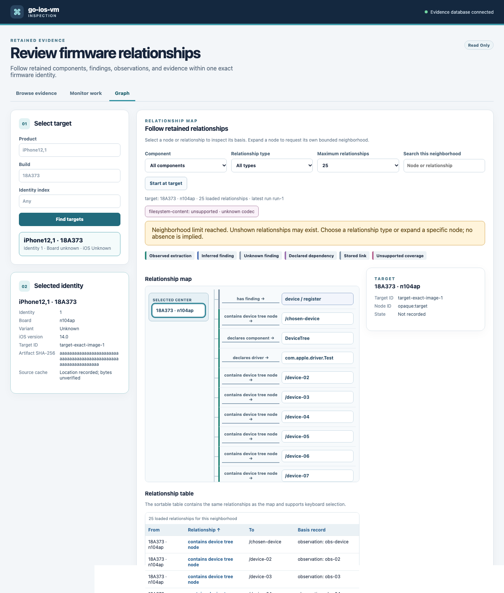

# Visual relationship review

Open the local UI and choose **Graph**. Select an exact firmware target by product, build, and identity. The graph starts at that target and reads one bounded neighborhood from `GET /api/v1/graph`; selecting **Expand this node** replaces it with the chosen node's neighborhood. The browser passes server-returned node IDs through unchanged. It does not infer links from equal labels or retain a whole-image graph in memory.

The relationship map and sortable table show the same loaded edges. Search filters those loaded rows only. The arrow points from the stored `from` node to `to`, and the selected detail pane shows the source record, extractor, run associations, and logical source location when recorded. Finding and observation nodes link to their read-only details. A declared driver dependency is a declaration, not proof that the driver was observed or works at runtime. Inferred and unknown finding revisions are labelled separately from extracted observations. Unsupported or unexamined latest-run coverage and a truncated neighborhood remain visible; neither an empty filtered result nor a truncated neighborhood proves absence.



## Repeat the browser interaction test

The opt-in test serves the production browser assets with a fixture API. It checks expansion, component and type filters, local search, keyboard-focusable node and table controls, source/detail navigation, and a 70-edge neighborhood that never requests more than 100 edges. It requires a local Chromium or Chrome binary but no PostgreSQL:

```sh
GOIOSVM_BROWSER=/path/to/chromium \
go test ./internal/webui -run TestGraphBrowserInteractions -count=1 -v
```

Set `GOIOSVM_BROWSER_GRAPH_SCREENSHOT=/tmp/graph.png` to capture the fixture view. This checked-in screenshot uses fixture identifiers and contains no proprietary image bytes.

## Real-image verification for integrated acceptance

After the read API and UI branches are combined, use a **separate migrated evidence database** containing the pinned iPhone12,1 iOS 14 and 15 inspections. Start `bin/go-ios-vm ui serve` with that database's `GOIOSVM_DATABASE_URL`. In Browse evidence, select the exact product, build, and identity for each image, then open Graph. Record the target ID and latest run ID with each capture so two identical labels cannot be mistaken for one node. Expand a device-tree property through observation/evidence, a driver declaration, a finding through revision and basis, and an APFS path if present. For both complete and partial coverage cases, capture the visible gap and truncation notices and verify that the relationship table has the same edge count as the map. Keep screenshots to graph metadata and logical source coordinates; omit retained byte previews, local archive paths, and database credentials. Issue #48 owns the integrated real-image capture gate.
